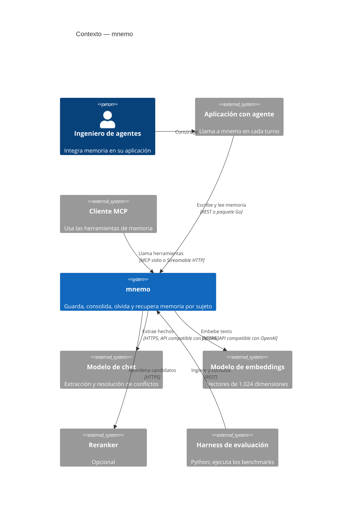
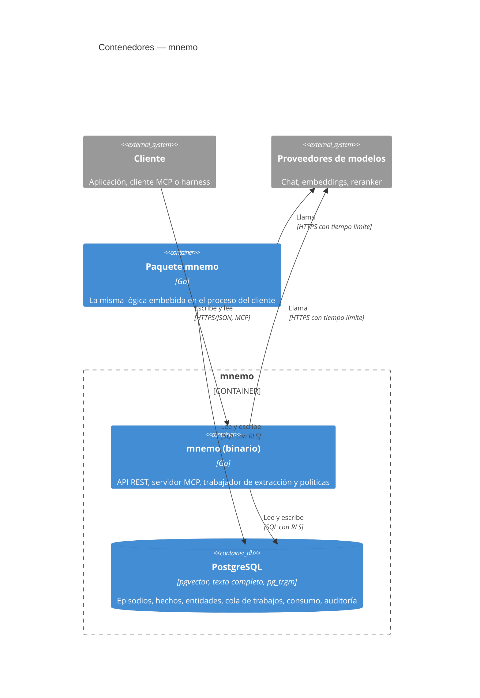
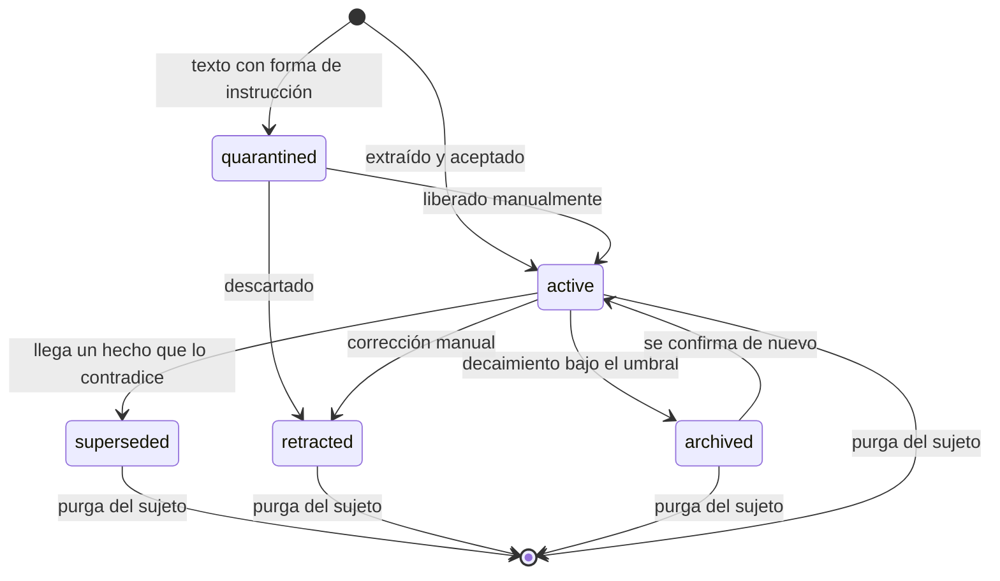
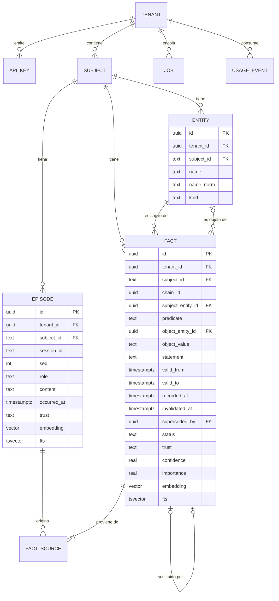

# mnemo — arquitectura

Estado: aceptada para implementación · Última revisión: 2026-11-21 ([ADR-0007](adr/ADR-0007-operaciones-sin-inquilino-y-ajustes-del-plan.md))

Requisitos en [prd.md](prd.md). Decisiones irreversibles en [adr/](adr/README.md).

## 1. Preguntas de encuadre

- **Dominio.** Memoria de un sujeto: episodios inmutables y hechos con validez. Invariantes: (I1) un episodio nunca se modifica; (I2) un hecho nunca se borra por conflicto, solo cambia de estado; (I3) por cada cadena de sustitución hay como máximo un hecho activo; (I4) ninguna fila es visible fuera de su inquilino; (I5) tras una purga no queda ninguna fila del sujeto.
- **Límites.** Lo que debe ir junto en una transacción: insertar el hecho nuevo y cerrar el anterior (I3); guardar episodios y encolar su extracción.
- **Datos.** Todo en PostgreSQL. Los vectores son datos derivados: se pueden regenerar desde el texto.
- **Carga.** Muchas lecturas cortas (una por turno del agente), escrituras en ráfagas (un turno o una sesión entera), extracción lenta en segundo plano.
- **Fallo.** Los proveedores de modelos fallan o tardan. La lectura debe seguir respondiendo sin ellos, degradada.

## 2. Características de arquitectura

| Rango | Característica | Por qué está | Función de aptitud |
|---|---|---|---|
| **1 (rectora)** | **Evaluabilidad** — cada etapa es observable, repetible y desactivable | El proyecto vale por su número. Si una etapa no se puede medir o apagar, no hay ablación ni análisis de fallos | Prueba que ejecuta `recall` con cada fuente desactivada y exige resultados distintos y deterministas con el embebedor falso; toda llamada a modelo deja fila en `usage_events` |
| 2 | Aislamiento entre inquilinos | Datos personales de terceros en una instancia compartida | Suite de aislamiento que recorre todas las tablas con `tenant_id`; 0 filas ajenas |
| 3 | Integridad temporal | Sin I2 e I3 la respuesta a "qué era cierto antes" es falsa | Pruebas de propiedades sobre la máquina de estados de hechos; restricción única parcial en la base |
| 4 | Instalabilidad | "Un comando" es parte del posicionamiento y de lo que un revisor comprueba | Prueba de humo sobre `docker compose up` en CI; ≤ 6 dependencias directas |
| 5 | Rendimiento de lectura | `recall` está en el camino de cada turno del agente | Prueba de carga: p95 ≤ 400 ms sin reranker |
| 6 | Borrabilidad | Derecho de supresión; los vectores y resúmenes también son datos personales | Prueba que purga un sujeto y consulta `information_schema` para verificar que ninguna tabla con `subject_id` conserva filas |

La rectora desempata: cuando una optimización choca con poder medir o apagar una etapa, gana la medición.

### Árbol de utilidad

```
Utilidad
├── Evaluabilidad
│   ├── Ablación por petición ──── [cada fuente y etapa se apaga con un parámetro]          (A, A)
│   └── Coste atribuible ───────── [tokens por operación y modelo en usage_events]          (A, M)
├── Aislamiento
│   └── Lectura cruzada ────────── [0 filas ajenas aun si el código olvida un filtro]       (A, A)
├── Integridad temporal
│   └── Sustitución atómica ────── [nunca dos activos en una cadena, bajo concurrencia]     (A, A)
├── Instalabilidad
│   └── Arranque ───────────────── [docker compose up → /readyz 200 en < 60 s]              (A, B)
├── Rendimiento
│   └── recall ─────────────────── [p95 ≤ 400 ms, 5.000 hechos y 10.000 episodios]          (A, M)
└── Borrabilidad
    └── Purga completa ─────────── [0 filas del sujeto en cualquier tabla, incluidas nuevas] (A, M)
```

### Escenarios de calidad para las hojas (A, A)

- **Ablación.** El harness de evaluación *(fuente)* envía la misma consulta con `sources` distinto *(estímulo)* sobre una ingesta ya hecha *(entorno)* al módulo de recuperación *(artefacto)*; la respuesta usa solo las fuentes pedidas e informa cuáles se usaron *(respuesta)*, sin reingestar y con el mismo resultado en dos ejecuciones consecutivas *(medida)*.
- **Lectura cruzada.** Un cliente autenticado del inquilino B *(fuente)* pide un recurso con un identificador del inquilino A *(estímulo)* en operación normal *(entorno)* a cualquier endpoint o herramienta *(artefacto)*; recibe 404 o lista vacía *(respuesta)*, 0 filas de A en 100 % de los casos de la suite, también cuando la consulta SQL se ejecuta sin cláusula de inquilino *(medida)*.
- **Sustitución atómica.** Dos trabajos de extracción *(fuente)* aplican a la vez hechos que contradicen al mismo hecho activo *(estímulo)* bajo concurrencia *(entorno)* sobre el resolutor *(artefacto)*; uno gana y el otro se reintenta sobre el estado nuevo *(respuesta)*; tras 1.000 repeticiones nunca hay dos hechos activos con el mismo `chain_id` *(medida)*.

## 3. Estilo

**Monolito modular en un solo binario**, con trabajador en proceso y una base PostgreSQL. Un único cuanto de arquitectura.

| Criterio | Este proyecto | Veredicto |
|---|---|---|
| Tamaño del equipo | 1 persona | Un desplegable |
| Despliegue independiente | No se necesita | Acoplado está bien |
| Consistencia | I3 exige transacciones | Todo en un RDBMS |
| Madurez operativa | Sin operaciones | Un proceso, una base |

Dentro del binario, puertos y adaptadores solo donde hay un tercero que falla o cambia: modelo de chat, embeddings, reranker. El resto es código directo sobre SQL.

**Arquitectura sacrificable, dicho en voz alta:** el esquema de hechos y el protocolo de evaluación están pensados para durar; los prompts de extracción, los umbrales y la heurística de entidades se van a reescribir, y están aislados para que eso no toque nada más.

## 4. Diagramas

### Contexto



### Contenedores



### Escritura: episodio síncrono, extracción asíncrona

```mermaid
sequenceDiagram
    autonumber
    participant C as Cliente
    participant A as API
    participant D as PostgreSQL
    participant W as Trabajador
    participant E as Embeddings
    participant L as Modelo de chat

    C->>A: POST /v1/episodes (Idempotency-Key)
    A->>E: embed(mensajes)
    A->>D: BEGIN; insertar episodios; insertar trabajo extract; COMMIT
    A-->>C: 202 {episode_ids, job_id}
    W->>D: tomar trabajo (FOR UPDATE SKIP LOCKED)
    W->>L: extraer hechos (JSON con esquema)
    W->>E: embed(enunciados)
    W->>D: buscar hechos activos similares del sujeto
    alt hay candidatos en conflicto
        W->>L: veredicto por candidato (add | supersede | duplicate | reject)
    end
    W->>D: BEGIN; aplicar transiciones; registrar consumo; trabajo=done; COMMIT
```

Si el embebedor falla en el paso 2, los episodios se guardan sin vector y un trabajo `embed` los completa después; la escritura no se rechaza.

### Lectura: sin modelo generativo

```mermaid
sequenceDiagram
    autonumber
    participant C as Cliente
    participant A as API
    participant E as Embeddings
    participant D as PostgreSQL
    participant R as Reranker

    C->>A: POST /v1/recall {query, as_of, max_tokens, sources}
    A->>E: embed(query)
    par candidatos
        A->>D: hechos por vector
        A->>D: hechos por texto completo
        A->>D: episodios por vector
        A->>D: episodios por texto completo
        A->>D: hechos por grafo (entidades de la consulta + 1 salto)
    end
    A->>A: filtrar por estado, validez y confianza; fusionar con RRF
    opt reranker configurado y pedido
        A->>R: reordenar 50 → N (límite 1,5 s)
    end
    A->>A: ensamblar contexto dentro de max_tokens
    A-->>C: 200 {facts, episodes, context, no_evidence, degraded, usage, timings}
```

### Ciclo de vida de un hecho



Transiciones prohibidas, con prueba: `superseded → active`, `retracted → active`, `archived → superseded`.

## 5. Módulos

| Módulo (ruta) | Dueño de | Interfaz hacia el resto |
|---|---|---|
| `mnemo` (raíz, público) | La API pública y los tipos | `Open`, `Memory`, `Scope` (sección 8) |
| `internal/store` | Esquema, migraciones, todas las consultas SQL, el contexto de inquilino para RLS | Funciones por caso de uso; nadie más escribe SQL |
| `internal/extract` | Prompt y esquema de extracción, validación de la salida, detección de texto con forma de instrucción | `Extract(ctx, chat, w Window) ([]Candidate, Usage, error)` |
| `internal/resolve` | **Núcleo puro**: máquina de estados de hechos y cálculo de transiciones | `Plan(c, existing, v, now) ([]Transition, error)` |
| `internal/retrieve` | **Núcleo puro**: fusión RRF, filtros temporales, ensamblado del contexto | `FuseRRF`, `FilterAsOf`, `Assemble` |
| `internal/policy` | **Núcleo puro**: puntuación de decaimiento, selección de duplicados | `DecayScore`, `MergeGroups` |
| `internal/provider` | Adaptadores HTTP de chat, embeddings y reranker; tiempos límite, reintentos, consumo | Interfaces `ChatModel`, `Embedder`, `Reranker` |
| `internal/jobs` | Cola en PostgreSQL y bucle del trabajador | `Enqueue`, `Run` |
| `internal/httpapi` | Rutas, autenticación, validación, sobre de error, límites de tasa | Solo traduce HTTP ↔ `mnemo` |
| `internal/mcpserver` | Definición de las cuatro herramientas y su transporte | Solo traduce MCP ↔ `mnemo` |
| `cmd/mnemo` | Composición: configuración, subcomandos `serve`, `mcp`, `migrate`, `tenant`, `key` | — |
| `eval/` (Python) | Harness, cargadores de datos, líneas base, juez, informes, cliente HTTP | Línea de comandos `mnemo-eval` |

Reglas de dependencia, verificadas en CI por `tools/archcheck`: los tres núcleos puros no importan `internal/store`, `internal/provider`, `net/http` ni `database/sql`; de los paquetes del módulo, `internal/httpapi` e `internal/mcpserver` solo importan el paquete raíz e `internal/config` (la verificación de credenciales la expone el raíz como `(*Memory).Authenticate`; ADR-0007); el paquete raíz no importa el SDK de MCP ni `net/http` en modo servidor; `cmd/mnemo` compone y puede importar cualquier paquete interno.

Relación entre contextos: el harness es *conformista* respecto al formato de los benchmarks; mnemo se protege de los proveedores de modelos con una *capa anticorrupción* (`internal/provider`), y publica un *servicio de anfitrión abierto* (REST con OpenAPI, MCP).

## 6. Modelo de datos

### Entidad-relación



### Tablas

Todas llevan `tenant_id uuid not null` salvo `tenants`, `schema_migrations` e `instance_settings`. Identificadores `uuid` generados con `gen_random_uuid()`.

```sql
tenants(id uuid pk, name text unique, fts_config regconfig default 'english', created_at timestamptz)

api_keys(id uuid pk, tenant_id, key_hash bytea unique, prefix text,
         scopes text[] check (scopes <@ array['read','write','admin']),
         subject_id text null,            -- si no es null, la credencial solo ve ese sujeto
         created_at, revoked_at timestamptz null)

subjects(tenant_id, id text, policy jsonb default '{}', purged_at timestamptz null,
         created_at, primary key (tenant_id, id))

episodes(id uuid pk, tenant_id, subject_id text, session_id text, seq int,
         role text check (role in ('user','assistant','tool','system','summary')),
         content text check (octet_length(content) <= 32768),
         occurred_at timestamptz, recorded_at timestamptz default now(),
         trust text check (trust in ('user','assistant','untrusted')),
         embedding vector(1024) null, fts tsvector, token_count int, api_key_id uuid,
         unique (tenant_id, subject_id, session_id, seq))

entities(id uuid pk, tenant_id, subject_id text, name text, name_norm text, kind text,
         aliases text[] default '{}', created_at,
         unique (tenant_id, subject_id, name_norm, kind))

facts(id uuid pk, tenant_id, subject_id text,
      chain_id uuid not null,              -- compartido por un hecho y todos sus sucesores
      subject_entity_id uuid references entities, predicate text,
      object_entity_id uuid null references entities, object_value text null,
      statement text check (octet_length(statement) <= 2048),
      valid_from timestamptz null, valid_to timestamptz null,     -- tiempo del mundo
      recorded_at timestamptz default now(), invalidated_at timestamptz null,  -- tiempo del sistema
      superseded_by uuid null references facts,
      status text check (status in ('active','superseded','retracted','archived','quarantined')),
      trust text check (trust in ('user','assistant','untrusted')),
      confidence real, importance real default 0.5,
      access_count int default 0, last_accessed_at timestamptz null, last_confirmed_at timestamptz,
      embedding vector(1024) null, fts tsvector,
      check (valid_to is null or valid_from is null or valid_to >= valid_from))

fact_sources(id bigserial pk, tenant_id,
             fact_id uuid not null references facts on delete cascade,
             episode_id uuid null references episodes on delete set null,
             session_id text not null, seq int not null,          -- instantánea de procedencia,
             occurred_at timestamptz not null, role text not null, -- copiada al insertar (ADR-0007)
             unique (tenant_id, fact_id, session_id, seq))

jobs(id uuid pk, tenant_id, subject_id text not null,
     kind text check (kind in ('extract','embed','consolidate','forget','purge')),
     dedupe_key text, payload jsonb,
     status text check (status in ('queued','running','done','failed','cancelled')),
     attempts int default 0, run_after timestamptz default now(), locked_at timestamptz null,
     error text null, result jsonb null, created_at, finished_at timestamptz null,
     unique (tenant_id, subject_id, kind, dedupe_key))   -- session_id solo es único por sujeto (ADR-0007)

usage_events(id bigserial pk, tenant_id, subject_id text null, operation text, provider text,
             model text, input_tokens int, output_tokens int, duration_ms int, job_id uuid null, created_at)

idempotency_keys(tenant_id, key text, subject_id text not null, request_hash bytea,
                 status_code int, response jsonb, created_at, primary key (tenant_id, subject_id, key))

instance_settings(key text pk, value text not null)   -- sin datos de inquilino; guarda el modelo de embeddings (ADR-0006, ADR-0007)

audit_log(id bigserial pk, tenant_id, api_key_id uuid, action text, subject_ref bytea,
          target text, detail jsonb, at timestamptz default now())   -- solo INSERT
```

Índices y restricciones que sostienen las invariantes:

- `create unique index facts_one_active_per_chain on facts (tenant_id, chain_id) where status = 'active'` — invariante I3 en la base, no solo en el código.
- `(tenant_id, subject_id, status)` en `facts`; `(tenant_id, subject_id, occurred_at)` en `episodes`.
- GIN sobre `fts` en `facts` y `episodes`; GIN de trigramas sobre `entities.name_norm`.
- **Sin índice vectorial en v1.** La búsqueda es `order by embedding <=> $1` restringida por `(tenant_id, subject_id)`, exacta, sobre unos miles de filas. Se revisa con A-7.
- `audit_log.subject_ref` es `sha256(tenant_id || subject_id)`: permite demostrar que una purga ocurrió sin conservar el identificador.
- `fact_sources` conserva la procedencia aunque el episodio desaparezca. Al resumir, sus filas se reapuntan al episodio `summary` y la instantánea (`session_id`, `seq`, `occurred_at`, `role`) conserva la ronda original; si un episodio se borra por otra vía, `episode_id` pasa a nulo y la instantánea sigue ahí.

Seguridad a nivel de fila: `alter table … enable row level security; force row level security;` y la política `using (tenant_id = current_setting('app.tenant_id')::uuid)` en todas las tablas con `tenant_id`. La aplicación se conecta con un rol sin `BYPASSRLS` ni propiedad de las tablas, y ejecuta `set local app.tenant_id` al abrir cada transacción. Las migraciones usan otro rol (`mnemo_admin`, con `BYPASSRLS`), cuya URL (`MNEMO_ADMIN_DATABASE_URL`) solo leen `mnemo migrate`, `mnemo tenant create` y `mnemo key create`; el servicio no la tiene. `mnemo_app` recibe tabla por tabla `SELECT, INSERT, UPDATE, DELETE` o menos, nunca `TRUNCATE` (no pasa por RLS) ni `TRIGGER`. Ver ADR-0003 y ADR-0007.

Tres operaciones no conocen el inquilino de antemano y pasan por funciones `SECURITY DEFINER` de `mnemo_admin`, con `search_path` fijado, sin parámetros de inquilino y con `EXECUTE` solo para `mnemo_app`: `mnemo_lookup_api_key(p_key_hash)` (devuelve inquilino, credencial, ámbitos y sujeto), `mnemo_claim_job()` (retira los trabajos abandonados, turno entre inquilinos y `FOR UPDATE SKIP LOCKED`; devuelve el trabajo y su inquilino) y `mnemo_cleanup()` (limpieza por antigüedad). Todo lo que sigue va bajo `set local app.tenant_id`. Como `mnemo_admin` es dueño con `BYPASSRLS`, `mnemo_app` no recibe privilegios sobre vistas materializadas ni sobre vistas sin `security_invoker = true`. Ver ADR-0007.

### Consistencia e idempotencia

Consistencia fuerte dentro de PostgreSQL; nada eventual salvo la extracción, que es una cola con al-menos-una-vez.

| Operación mutante | Clave | Almacén | TTL | Repetición | En curso |
|---|---|---|---|---|---|
| `POST /v1/episodes` | Cabecera `Idempotency-Key` (opcional) y, siempre, la clave natural `(tenant, subject, session_id, seq)` | `idempotency_keys`, escrita en la misma transacción que los episodios | 24 h | Misma clave y cuerpo → respuesta original. Misma clave, otro cuerpo → 409 `IDEMPOTENCY_CONFLICT`. Mismo `(session_id, seq)` con otro contenido → 409 `EPISODE_CONFLICT` | La segunda petición espera el bloqueo de fila y recibe la respuesta guardada |
| Trabajo `extract` | `dedupe_key = session_id:seq_desde-seq_hasta`, única por sujeto | `jobs` (único por `tenant_id, subject_id, kind, dedupe_key`) | permanente | Reejecutar produce las mismas transiciones o `duplicate`; nunca un segundo hecho activo (I3) | `FOR UPDATE SKIP LOCKED` |
| `POST …/consolidate`, `POST …/forget` | `dedupe_key = fecha UTC`, única por sujeto | `jobs` | 24 h | Devuelve el trabajo existente | idem |
| `DELETE /v1/subjects/{id}` | El propio sujeto | `subjects.purged_at` | permanente | Idempotente: la segunda llamada con una credencial del inquilino no ligada a sujeto devuelve el recibo con ceros; la credencial ligada al sujeto purgado ya no existe y recibe 401 (ADR-0007, decisión 10) | La marca `purged_at` hace fallar cualquier escritura tardía |
| `POST /v1/facts/{id}/retract` | El hecho | estado | permanente | Idempotente | — |

Cada elemento de acumulación tiene su reciclaje: `idempotency_keys` (24 h), `jobs` terminados (30 días, salvo los `extract` en `failed`, que retira la purga), `usage_events` (180 días), los tres con una limpieza diaria del trabajador por `mnemo_cleanup()`.

### Migraciones

Archivos SQL numerados en `internal/store/migrations/`, embebidos en el binario y aplicados por `mnemo migrate` dentro de una transacción por archivo. Solo cambios aditivos; renombrar es añadir, copiar y eliminar en versiones distintas. La dimensión del vector (1.024) es parte del esquema: cambiarla es una migración con re-embebido (ADR-0006).

## 7. API del servicio

REST con JSON bajo `/v1`, contrato primero en `api/openapi.yaml`. Autenticación: `Authorization: Bearer mnemo_<prefijo>_<secreto>`.

| Método y ruta | Ámbito | Qué hace | Respuestas |
|---|---|---|---|
| `POST /v1/episodes` | write | Guarda mensajes de un sujeto y encola la extracción. `?wait=true` espera al trabajo (máx. 60 s) | 202 · 200 con `wait` · 409 · 413 · 422 |
| `POST /v1/recall` | read | Recupera memoria para una consulta | 200 |
| `GET /v1/subjects/{subject}/facts` | read | Lista hechos; filtros `status`, `entity`, `as_of`; paginación por cursor | 200 |
| `GET /v1/subjects/{subject}/timeline?entity=` | read | Cadena de hechos de una entidad ordenada por validez | 200 |
| `GET /v1/facts/{id}` | read | Un hecho con su procedencia y su cadena | 200 · 404 |
| `POST /v1/facts/{id}/retract` | write | Retracta un hecho, con motivo | 200 · 404 |
| `POST /v1/facts/{id}/release` | admin | Saca un hecho de cuarentena | 200 · 404 · 409 |
| `POST /v1/subjects/{subject}/consolidate` | write | Encola consolidación | 202 |
| `POST /v1/subjects/{subject}/forget` | write | Encola la pasada de decaimiento | 202 |
| `GET /v1/subjects/{subject}/export` | read | Exporta la memoria como NDJSON | 200 |
| `DELETE /v1/subjects/{subject}` | admin | Purga | 200 con recibo |
| `GET /v1/jobs/{id}` | read | Estado y resultado de un trabajo | 200 · 404 |
| `GET /v1/usage?from=&to=&group_by=` | read | Tokens y llamadas por operación y modelo | 200 |
| `GET /healthz`, `GET /readyz`, `GET /metrics` | sin credencial | Vida, disponibilidad (base alcanzable y migrada), métricas en formato de texto de Prometheus | 200 · 503 |

`recall` es `POST` porque lleva cuerpo; no muta nada visible. La actualización de `access_count` se hace fuera de la petición, por lotes, y se apaga con `track_access=false` (el harness la apaga para que las corridas sean repetibles).

Petición y respuesta de `recall`:

```json
{
  "subject": "user-123",
  "query": "¿dónde vive?",
  "as_of": "2026-05-01T00:00:00Z",
  "max_tokens": 2000,
  "sources": ["facts.vector", "facts.fts", "facts.graph", "episodes.vector", "episodes.fts"],
  "rerank": false,
  "include_history": true,
  "include_untrusted": false,
  "track_access": true
}
```

```json
{
  "facts": [{
    "id": "…", "statement": "Vive en Bogotá", "predicate": "lives_in",
    "valid_from": "2026-03-10T00:00:00Z", "valid_to": "2026-08-02T00:00:00Z",
    "status": "superseded", "trust": "user", "score": 0.031,
    "sources": [{"episode_id": "…", "session_id": "s-7", "seq": 3, "occurred_at": "2026-03-10T15:04:00Z", "role": "user"}]
  }],
  "episodes": [{"id": "…", "session_id": "s-7", "seq": 4, "role": "user", "content": "…", "occurred_at": "…", "score": 0.027}],
  "context": "<memory>\n[hecho · válido 2026-03-10 → 2026-08-02] Vive en Bogotá\n…\n</memory>",
  "no_evidence": false,
  "degraded": [],
  "usage": {"embedding_tokens": 9, "rerank_tokens": 0},
  "timings_ms": {"embed": 31, "candidates": 12, "fuse": 0, "rerank": 0, "assemble": 1, "total": 46}
}
```

En cada procedencia de `sources`, `session_id`, `seq`, `occurred_at` y `role` están siempre; `episode_id` es nulo si el episodio de origen ya no existe (ADR-0007, decisión 4).

Sobre de error único, nunca 200 con error:

```json
{"error": {"code": "IDEMPOTENCY_CONFLICT", "message": "…", "details": {}}}
```

Códigos: `UNAUTHENTICATED` 401 · `FORBIDDEN` 403 (ámbito insuficiente o sujeto distinto del de la credencial) · `NOT_FOUND` 404 · `IDEMPOTENCY_CONFLICT`, `EPISODE_CONFLICT`, `INVALID_STATE` 409 · `PAYLOAD_TOO_LARGE` 413 · `VALIDATION_FAILED`, `INVALID_OCCURRED_AT` 422 · `RATE_LIMITED` 429 con `Retry-After` · `INTERNAL` 500 · `UNAVAILABLE` 503.

Versionado en la URL. Añadir campos opcionales no rompe; quitar o renombrar exige `/v2`.

### Herramientas MCP

Cuatro herramientas de nivel de flujo de trabajo, no un envoltorio de cada endpoint, siguiendo la guía de diseño de herramientas de [Anthropic](https://www.anthropic.com/engineering/writing-tools-for-agents). Ninguna recibe `subject` ni `tenant`: los fija la credencial.

| Herramienta | Argumentos | Anotación | Devuelve |
|---|---|---|---|
| `remember` | `content` (texto), `occurred_at` (opcional) | no destructiva, no idempotente | Confirmación con el número de episodios guardados |
| `recall` | `query`, `as_of` (opcional), `max_tokens` (por defecto 1.500, tope 4.000) | solo lectura | El contexto redactado; si no hay evidencia, un mensaje que lo dice |
| `timeline` | `entity` | solo lectura | La cadena de hechos de la entidad con fechas |
| `forget` | `fact_id` y `reason`, o `everything: true` con `confirm` igual al identificador del sujeto | destructiva | Recibo |

Transportes: stdio (`mnemo mcp`, credencial por variable de entorno) y Streamable HTTP en `/mcp` del servicio (misma cabecera `Bearer`). Revisión de protocolo objetivo: 2026-07-28, la que el SDK oficial de Go soporta desde v1.7.0 ([README](https://github.com/modelcontextprotocol/go-sdk)). El registro de herramientas usa `mcp.AddTool[In, Out]` ([referencia](https://pkg.go.dev/github.com/modelcontextprotocol/go-sdk/mcp)). OAuth para MCP queda diferido (sección 10).

## 8. API pública del paquete Go

Firmas previstas. Ruta de importación según el supuesto A-1.

```go
package mnemo

func Migrate(ctx context.Context, adminURL string) error  // URL de mnemo_admin, dueño del esquema (ADR-0007, decisión 17)
func Open(ctx context.Context, pool *pgxpool.Pool, cfg Config) (*Memory, error)

type Config struct {
    Chat      ChatModel   // obligatorio para extraer; nil = solo memoria episódica
    Embedder  Embedder    // obligatorio
    Reranker  Reranker    // opcional
    Logger    *slog.Logger
    Observer  Observer    // opcional: recibe tiempos por etapa y consumo
}

func (m *Memory) Scope(tenantID uuid, subjectID string) *Scope
func (m *Memory) RunWorker(ctx context.Context) error   // bloquea hasta que ctx termina
func (m *Memory) Authenticate(ctx context.Context, plaintext string) (Principal, error) // ADR-0007, decisión 3

func (s *Scope) Remember(ctx context.Context, msgs []Message, opts ...RememberOption) (RememberResult, error)
func (s *Scope) Recall(ctx context.Context, query string, opts ...RecallOption) (RecallResult, error)
func (s *Scope) Timeline(ctx context.Context, entity string) ([]Fact, error)
func (s *Scope) Facts(ctx context.Context, f FactFilter) (FactPage, error)
func (s *Scope) Retract(ctx context.Context, factID uuid, reason string) error
func (s *Scope) Consolidate(ctx context.Context) (JobRef, error)
func (s *Scope) Forget(ctx context.Context) (JobRef, error)
func (s *Scope) Export(ctx context.Context, w io.Writer) error
func (s *Scope) Purge(ctx context.Context) (DeletionReceipt, error)

// Opciones: WithSession(id), WithIdempotencyKey(k), WaitForExtraction(d),
//           AsOf(t), MaxTokens(n), Sources(...Source), WithRerank(), IncludeHistory(),
//           IncludeUntrusted(), WithoutAccessTracking()

type ChatModel interface { Complete(ctx context.Context, req ChatRequest) (ChatResponse, error) }
type Embedder  interface { Embed(ctx context.Context, texts []string) ([][]float32, Usage, error); Dim() int }
type Reranker  interface { Rerank(ctx context.Context, query string, docs []string) ([]float64, Usage, error) }
```

`uuid` es `[16]byte` (el tipo de `pgx/pgtype`), para no añadir una dependencia. El paquete entrega adaptadores listos: `mnemo.OpenAICompatibleChat(baseURL, key, model)`, `mnemo.OpenAICompatibleEmbedder(baseURL, key, model, dim)`, `mnemo.HTTPReranker(url, key)`, y `mnemo.FakeEmbedder(dim)` determinista para pruebas.

Uso previsto, que será un `Example` ejecutable:

```go
mem, _ := mnemo.Open(ctx, pool, mnemo.Config{Chat: chat, Embedder: emb})
go mem.RunWorker(ctx)
u := mem.Scope(tenant, "user-123")
u.Remember(ctx, []mnemo.Message{{Role: "user", Content: "Me mudé a Medellín", OccurredAt: now}})
r, _ := u.Recall(ctx, "¿dónde vive?", mnemo.MaxTokens(1500))
prompt := system + "\n" + r.Context
```

## 9. Algoritmos que fijan el comportamiento

**Extracción.** Una llamada por lote de mensajes nuevos de una sesión, con los cuatro mensajes anteriores como contexto y la fecha de la sesión. Salida JSON validada contra esquema: lista de `{subject, predicate, object, object_is_entity, statement, valid_from, valid_to, confidence, source_seq[]}`. Un candidato sin `source_seq` válido se descarta. La elección de extraer hechos y conservar además las rondas originales sigue el resultado de LongMemEval: indexar con clave ampliada por hechos mejoró el recall@k un 9,4 % y la exactitud final un 5,4 % en promedio, mientras que sustituir el valor por hechos descompuestos perjudicó el rendimiento global ([artículo](https://arxiv.org/html/2410.10813v2)).

**Resolución de conflictos.** Para cada candidato: (1) se buscan los hechos activos del mismo sujeto con la misma entidad-sujeto y predicado, más los 5 más similares por vector; (2) sin vecinos → `add` sin llamar al modelo; (3) enunciado normalizado idéntico → `duplicate` sin llamar al modelo; (4) en otro caso, una llamada al modelo por lote devuelve un veredicto por candidato entre `add`, `supersede(ids)`, `duplicate(id)`, `reject`; (5) `internal/resolve.Plan` convierte el veredicto en transiciones y `internal/store` las aplica en una transacción. Como máximo dos llamadas al modelo por lote ingerido. El modelo propone; el código decide qué transiciones son legales.

**Entidades.** Normalización (minúsculas, sin acentos ni artículos), coincidencia exacta y, si no hay, similitud de trigramas ≥ 0,6 dentro del sujeto. Sin llamada al modelo.

**Recuperación.** Hasta 40 candidatos por fuente. Fuente de grafo: entidades cuyo nombre aparece en la consulta (trigramas y texto completo) → hechos donde son sujeto u objeto → un salto más por `object_entity_id`. Filtros antes de fusionar: estado (`active`; también `superseded` si `include_history`), validez respecto a `as_of`, confianza. Fusión por rango recíproco: `score(d) = Σ 1 / (60 + rango_i(d))`. Umbral de evidencia: si el mejor candidato vectorial tiene similitud coseno < 0,25 y no hay coincidencia léxica ni de grafo, `no_evidence = true` (valor inicial, se ajusta en el subconjunto de desarrollo). Ensamblado: hechos primero, luego la ronda de origen del hecho mejor situado, luego episodios; se corta al alcanzar `max_tokens`, estimadas como caracteres / 4.

**Decaimiento.** `score = importance × 0,5^(edad_días / 90) × (1 + ln(1 + access_count))`. Se archiva si `score < 0,05` y la última confirmación tiene más de 30 días. Valores iniciales; la ablación A8 los varía.

**Consolidación.** Grupos de hechos activos del mismo sujeto y entidad-sujeto con similitud coseno ≥ 0,92 → se conserva el más reciente, hereda las procedencias (unión de las filas de `fact_sources`) y los demás pasan a `archived` con `superseded_by` apuntándole (no a `superseded`: no dejaron de ser ciertos, solo sobran, y no deben aparecer como historia). Resumen de sesión: una llamada al modelo por sesión fuera de la ventana de retención; se guarda como episodio de rol `summary`, las filas de `fact_sources` de los originales se reapuntan a él y se borran los originales, todo en una transacción y solo si ningún trabajo `extract` de la sesión está `queued`, `running` o `failed` (un `done` ya retirado por la limpieza cuenta como terminado; ADR-0007, decisión 4).

## 10. Lo que deliberadamente no se construye todavía

| No se construye | Por qué puede esperar | Qué lo forzaría |
|---|---|---|
| Índice ANN (HNSW) | Búsqueda exacta por sujeto sobre miles de filas | A-7 falsado |
| OAuth 2.1 para MCP | Una credencial `Bearer` cubre el autoalojado | Un cliente MCP que exija el flujo de autorización del protocolo |
| API HTTP de administración de inquilinos | Los subcomandos `tenant` y `key` bastan y reducen superficie de ataque | Un nivel alojado |
| Trazas distribuidas (OpenTelemetry) | Un proceso; los tiempos por etapa ya van en la respuesta y en el registro | Segundo servicio o depuración que el registro no resuelva |
| SDK de TypeScript | Hay OpenAPI para generarlo | Un usuario que lo pida |
| Correferencia por modelo | Coste y latencia en escritura | Que el análisis de fallos atribuya > 15 % de los errores a entidades mal resueltas |
| Memoria compartida entre sujetos | No la mide ningún benchmark elegido | Caso de uso real |
| Varias réplicas del trabajador | `SKIP LOCKED` ya lo permite; no hace falta | Cola con más de 5 min de retraso sostenido |
| Cifrado a nivel de campo | Cifrado de disco del operador | Nivel alojado o requisito de un cliente |

## 11. Espina de decisiones

Decisiones reversibles tomadas localmente, que el trabajo posterior debe respetar:

### AD-1 — Un módulo Go, un binario con subcomandos
- **Afecta a:** todo. **Evita:** binarios que divergen en configuración. **Regla:** `serve`, `mcp`, `migrate`, `tenant`, `key` viven en `cmd/mnemo`.

### AD-2 — SQL escrito a mano sobre pgx, solo en `internal/store`
- **Afecta a:** persistencia. **Evita:** un ORM o generador como dependencia y SQL disperso. **Regla:** ningún otro paquete importa `pgx` salvo el raíz para el tipo del pool.

### AD-3 — Observabilidad sin dependencias: `log/slog` en JSON y `/metrics` propio
- **Afecta a:** servicio. **Evita:** arrastrar un SDK de métricas al grafo de dependencias. **Regla:** el paquete raíz recibe un `Observer`; el servicio lo conecta a contadores e histogramas de cubos fijos. Nunca se registra contenido de episodios ni de hechos, solo identificadores y recuentos.

### AD-4 — Estimación de tokens por caracteres / 4 dentro de mnemo
- **Afecta a:** FR-11. **Evita:** una dependencia de tokenizador por modelo. **Regla:** las tokens reales del lector las mide el harness con el `usage` del proveedor; mnemo solo promete un presupuesto aproximado.

### AD-5 — Pruebas de integración contra el PostgreSQL de `docker compose`
- **Afecta a:** pruebas. **Evita:** una dependencia de contenedores en el módulo. **Regla:** etiqueta de compilación `integration` y variable `MNEMO_TEST_DATABASE_URL`; cada prueba crea su propio inquilino, y la que reclama trabajos o limpia (ejecuta `mnemo_claim_job()` o `mnemo_cleanup()`, que actúan sobre todos los inquilinos) corre en una base propia de `storetest.IsolatedDB` (ADR-0007, decisión 2).

### AD-6 — Límite de tasa en memoria por credencial
- **Afecta a:** servicio. **Evita:** Redis. **Regla:** cubo de fichas por `api_key_id`; válido mientras haya una sola instancia (ligado a "varias réplicas" en la sección 10).

Mapa de propiedad:

| Capacidad | Vive en | Gobernada por |
|---|---|---|
| Qué transiciones de hecho son legales | `internal/resolve` | ADR-0002 |
| Quién ve qué fila | `internal/store` + políticas RLS | ADR-0003 |
| Qué número se publica y cómo | `eval/` + `docs/evaluation-plan.md` | ADR-0004 |
| Cuándo se extrae | `internal/jobs` | ADR-0005 |
| Con qué modelo y dimensión | `internal/provider` + esquema | ADR-0006 |
| Dónde vive el estado | PostgreSQL | ADR-0001 |
