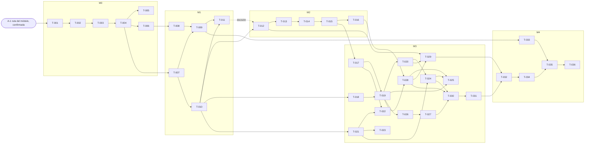

# mnemo — plan: hitos, dependencias y comprobación de consistencia

Estado: M0 cerrado en local el 2026-11-21, con el CI sin ejecutar (F-21) · Última revisión: 2026-11-21 (cierre de M0)

Las tareas están en [tasks.md](tasks.md). Este archivo guarda lo que se mira por encima de una tarea: los hitos, el grafo de dependencias y la comprobación de consistencia entre [prd.md](../prd.md), [architecture.md](../architecture.md), los [ADR](../adr/README.md) y el plan. La comprobación se repite al cerrar cada hito ([tasks.md, Definición de hecho](tasks.md#definición-de-hecho)).

## 1. Hitos

| Hito | Fecha objetivo | Tareas | Punto de control |
|---|---|---|---|
| M0 — Esqueleto andante | 2026-12-06 | T-001 … T-006 | Una petición real atraviesa API → dominio → PostgreSQL → respuesta, por REST y por MCP; el CI la ejecuta; el harness produce una tabla |
| M1 — Mayor riesgo: ¿la extracción aporta? | 2026-12-27 | T-007 … T-011 | Tabla real con B0, B1, B2 y mnemo sobre `dev60`, con coste medido por sesión; decisión de seguir, recortar o pivotar (R-1) |
| M2 — Cimientos | 2027-01-17 | T-012 … T-016 | Inquilinos, autenticación, idempotencia, cola y medición. Ninguna historia de M3 empieza antes de cerrar M2 |
| M3 — Historias | 2027-02-21 | T-017 … T-031 | Todos los FR-1 … FR-23 con su prueba `TestFR<n>_`; lista de rutas pendientes del contrato vacía |
| M4 — Evaluación y publicación | 2027-03-14 | T-032 … T-036 | Tabla completa con ablaciones, juez validado, análisis de fallos, versión 0.1.0 |

Si el apetito se agota, se recorta en el orden del [PRD](../prd.md#scope): US-10 → LoCoMo (T-033) → reranker (T-023) → resumen de episodios antiguos (parte de T-026) → transporte HTTP de MCP (parte de T-029). No se recortan: líneas base, aislamiento, purga, análisis de fallos.

## 2. Grafo de dependencias

Sacado de los campos "Depende de". Lo que no está en el grafo lo impone la regla de hitos. La arista discontinua T-011 → T-012 es de decisión: T-012 necesita la decisión de M1 registrada o aplazada de forma explícita, no el código de T-011 (ADR-0007, decisión 13).

Camino más largo en número de tareas (las tareas no tienen duración estimada, solo talla), sin contar la arista de decisión: T-001 → T-002 → T-003 → T-004 → T-007 → T-010 → T-012 → T-013 → T-014 → T-015 → T-017 → T-019 → T-020 → T-024 → T-030 → T-031 → T-032 → T-034 → T-035 → T-036. T-019 → T-026 → T-027 → T-030 es una alternativa de la misma longitud. Si T-012 esperase a que T-011 terminara, el camino pasaría por T-004 → T-006 → T-008 → T-009 → T-011 → T-012 y tendría dos tareas más. T-028 → T-025 no lo alarga: ninguna tarea depende de T-025.

## 3. Comprobación de consistencia

Ejecuciones: 2026-11-20, antes de escribir código; 2026-11-21, al cerrar M0 (las notas "Cierre de M0" de cada apartado y §3.6). Pasadas: cobertura de requisitos, trazabilidad de cada tarea, contradicciones con los ADR aceptados, coherencia entre documentos (modelo de datos, reglas de módulos, comandos) y listas "Tocar solo". Solo lectura: lo no trivial queda como hallazgo y, si hace falta una decisión, como pregunta en [open-questions.md](../open-questions.md).

### 3.1 Requisitos → tareas → prueba

La columna **Prueba** es la que exige [testing-strategy.md §6](../testing-strategy.md#6-trazabilidad) y que cuenta `go run ./tools/fr-trace -from 1 -to 23` (T-031). "Patrón" significa que el nombre solo aparece en el `-run` de Verificar, sin una prueba nombrada en "Hecho cuando".

| FR | Requisito | Tareas | Prueba | Estado |
|---|---|---|---|---|
| FR-1 | Episodio inmutable, confirmación sin esperar a la extracción | T-004, T-015 | `TestFR1_` (patrón, T-015); `TestEpisodes_` (T-004) | Cubierto |
| FR-2 | Idempotencia de escritura | T-014 | `TestFR2_` (patrón) | Cubierto |
| FR-3 | Extracción de hechos con procedencia | T-010, T-015 | `TestFR3_` (patrón) | Cubierto |
| FR-4 | Tiempo relativo resuelto contra la fecha del episodio | T-010 | `TestFR4_` (patrón) | Cubierto |
| FR-5 | Entidades y aristas del grafo | T-017, T-022 | `TestFR5_` (patrón) | Cubierto |
| FR-6 | Sustitución atómica con validez cerrada | T-018, T-019 | `TestFR6_SupersedeClosesValidity` | Cubierto |
| FR-7 | Duplicado → confirmación | T-018, T-019 | `TestFR7_DuplicateDoesNotAdd` | Cubierto |
| FR-8 | `as_of` y línea de tiempo | T-020 | `TestFR8_AsOfReturnsFactValidThen` | Cubierto |
| FR-9 | Fusión de fuentes desactivables | T-004, T-010, T-021, T-022 | `TestFR9_SourcesToggle` (T-021); `TestRecall_Deterministic` (T-004) | Cubierto (F-8 resuelto, ADR-0007) |
| FR-10 | Reranker con degradación | T-023 | `TestFR10_RerankTimeoutDegrades` | Cubierto |
| FR-11 | Contexto acotado con procedencia | T-013, T-024 | `TestFR11_ProvenanceOnEveryItem` | Cubierto |
| FR-12 | Ausencia de evidencia | T-024 | `TestFR12_NoEvidence` | Cubierto |
| FR-13 | Fusión de duplicados | T-026 | `TestFR13_MergeKeepsProvenance` | Cubierto |
| FR-14 | Resumen de episodios antiguos | T-026 | `TestFR14_SummarizeOnlyAfterExtraction` | Cubierto (F-3 resuelto, ADR-0007) |
| FR-15 | Olvido por decaimiento | T-027 | `TestFR15_ArchivedExcludedAndRestorable` | Cubierto |
| FR-16 | Purga con recibo | T-028 | `TestFR16_ReceiptMatchesCounts`, `TestPurge_NoRowsLeftAnyTable` | Cubierto (F-9 resuelto, ADR-0007) |
| FR-17 | Retractación auditada | T-028 | `TestFR17_RetractExcludesAndAudits` | Cubierto |
| FR-18 | Exportación | T-028 | `TestFR18_ExportRoundTrip` | Cubierto |
| FR-19 | Credencial ligada a inquilino y sujeto; 404 uniforme | T-012, T-013 | `TestFR19_` (patrón) | Cubierto |
| FR-20 | Confianza y cuarentena | T-025 | `TestFR20_UntrustedExcludedByDefault`, `TestFR20_InstructionQuarantined` | Cubierto |
| FR-21 | Herramientas MCP, sujeto fijado por la credencial | T-005, T-029 | `TestFR21_SubjectBoundByCredential` | Cubierto |
| FR-22 | Paquete Go sin servidor HTTP | T-004, T-030 | `TestFR22_LibraryWithoutHTTP` | Cubierto |
| FR-23 | Consumo y tiempos por etapa | T-007, T-016, T-032 | `TestFR23_` (patrón); `TestUsage_EveryProviderCallRecorded` | Cubierto |
| FR-24 | Harness de un comando | T-006, T-008, T-009, T-011, T-032, T-033, T-034, T-035 | Harness (`mnemo-eval`), fuera de `fr-trace` | Cubierto |
| FR-25 | Un comando levanta servicio y base | T-001, T-002, T-003, T-036 | Humo: `docker compose up -d --wait && curl -fsS http://127.0.0.1:8080/readyz` | Cubierto |

Cierre de M0 (2026-11-21). Implementado en parte, con pruebas en el código: FR-1 (episodio inmutable: `TestEpisodes_*` en `integration_test.go`, `internal/store` e `internal/httpapi`; `TestFR1_` llega con T-015), FR-9 (solo la fuente vectorial: `TestRecall_Deterministic`, `TestRecall_OrdersByCosineSimilarity`), FR-21 (`recall` por stdio con el sujeto fijado por `MNEMO_MCP_SUBJECT`: `TestRecall_InputSchemaHasNoSubjectOrTenant`, `TestRecall_ReturnsWhatRememberStored`), FR-22 (paquete raíz con `Open`, `Scope`, `Remember`, `Recall`), FR-24 (`mnemo-eval run` con `smoke.yaml` y modelos falsos) y FR-25 (el humo pasa en local). Ningún FR cambia de tareas ni de prueba, y la cobertura sigue en 25/25. Sin `TestFR<n>_` todavía, como prevé el plan.

### 3.2 Tareas → requisito y decisión

| Tarea | Hito | Implementa | Decisión |
|---|---|---|---|
| T-001 | M0 | FR-25 (parte) | AD-1, AD-3, ADR-0007 |
| T-002 | M0 | FR-25 (parte) | ADR-0001, ADR-0003, ADR-0007 |
| T-003 | M0 | FR-25 | AD-1, SM-C5, security-baseline §8, ADR-0007 |
| T-004 | M0 | FR-1, FR-9, FR-22 (parte) | ADR-0001, ADR-0006, ADR-0007 |
| T-005 | M0 | FR-21 (parte) | ADR-0003, ADR-0007 |
| T-006 | M0 | FR-24 (parte) | ADR-0004, ADR-0007 |
| T-007 | M1 | FR-23 (parte) | ADR-0006, ADR-0007 (decisión 14) |
| T-008 | M1 | FR-24 (parte) | ADR-0004 |
| T-009 | M1 | FR-24 | ADR-0004, ADR-0007 (decisión 14) |
| T-010 | M1 | FR-3, FR-4, FR-9 | ADR-0002, ADR-0007 |
| T-011 | M1 | FR-24 | ADR-0002, ADR-0004, ADR-0007 (decisión 14) |
| T-012 | M2 | FR-19 | ADR-0003, ADR-0007 |
| T-013 | M2 | FR-11, FR-19 | architecture §7 |
| T-014 | M2 | FR-2 | architecture §6, ADR-0007 |
| T-015 | M2 | FR-1, FR-3 | ADR-0005, ADR-0007 |
| T-016 | M2 | FR-23 | AD-3, ADR-0006, ADR-0007 |
| T-017 | M3 | FR-5 | ADR-0001, ADR-0002, ADR-0007 |
| T-018 | M3 | FR-6, FR-7 | ADR-0002 |
| T-019 | M3 | FR-6, FR-7 | ADR-0002, ADR-0005 |
| T-020 | M3 | FR-8 | ADR-0002, ADR-0007 |
| T-021 | M3 | FR-9 | ADR-0001, ADR-0007 |
| T-022 | M3 | FR-9, FR-5 | ADR-0001 |
| T-023 | M3 | FR-10 | ADR-0006, ADR-0007 (decisión 14) |
| T-024 | M3 | FR-11, FR-12 | AD-4, ADR-0007 |
| T-025 | M3 | FR-20 | TH-3, TH-4, TH-5, ADR-0007 |
| T-026 | M3 | FR-13, FR-14 | ADR-0002, ADR-0005, ADR-0007 |
| T-027 | M3 | FR-15 | ADR-0002, ADR-0007 |
| T-028 | M3 | FR-16, FR-17, FR-18 | ADR-0003, ADR-0007, TH-13, TH-14, TH-18 |
| T-029 | M3 | FR-21 | ADR-0003, TH-2, TH-19, ADR-0007 |
| T-030 | M3 | FR-22 | architecture §8, ADR-0007 |
| T-031 | M3 | FR-1 … FR-23 (trazabilidad por nombre de prueba) | testing-strategy §5, §6, ADR-0001, ADR-0007 |
| T-032 | M4 | FR-23, FR-24 | ADR-0004, A-7 |
| T-033 | M4 | FR-24 | ADR-0004 |
| T-034 | M4 | FR-24 | ADR-0004, evaluation-plan §8, ADR-0007 (decisión 14) |
| T-035 | M4 | FR-24 | ADR-0004, ADR-0007 (decisión 14) |
| T-036 | M4 | FR-25 | security-baseline §8, ADR-0007 |

Cierre de M0 (2026-11-21): T-001 a T-006 están hechas y cada una implementa lo que dice su fila. T-003, T-004 y T-006 ampliaron su lista "Tocar solo" dentro de la propia tarea con una fila en [open-questions.md §3](../open-questions.md#3-anotaciones-que-deja-una-tarea); la regla está en Q-25, abierta. Siete archivos con anotaciones pendientes no están en ninguna lista "Tocar solo" de una tarea por hacer (F-22).

Decisiones reversibles de la [espina](../architecture.md#11-espina-de-decisiones) sin tarea que las cite: AD-2 (la aplican todas las tareas de `internal/store`), AD-5 (T-002 la materializa con la etiqueta `integration` y `MNEMO_TEST_DATABASE_URL`), AD-6 (T-013, 429 `RATE_LIMITED`). No es un hueco: son reglas transversales.

### 3.3 ADR aceptados → tareas

| ADR | Lo aplican | Comprobado que ninguna tarea… | Resultado |
|---|---|---|---|
| ADR-0001 PostgreSQL único | T-002, T-004, T-017, T-021, T-022 | …introduzca otro almacén, cola o caché externa (Redis, base vectorial, base de grafos); T-013 evita incluso una dependencia de YAML | Sin contradicción |
| ADR-0002 Hechos bitemporales | T-010, T-011, T-017 … T-020, T-026, T-027 | …borre o reescriba un hecho por conflicto; T-018 prohíbe `superseded → active`, `retracted → active`, `archived → superseded` | Sin contradicción |
| ADR-0003 RLS y credencial ligada a sujeto | T-002, T-005, T-012, T-028, T-029 | …dé al rol de la aplicación `BYPASSRLS` o propiedad, o acepte el sujeto como argumento MCP | Sin contradicción; las tensiones F-1 y F-2 las resuelve ADR-0007 |
| ADR-0004 Benchmark y protocolo | T-006, T-008, T-009, T-011, T-032 … T-035 | …ajuste sobre las 440 retenidas o meta cifras de terceros en la tabla propia | Sin contradicción |
| ADR-0005 Extracción asíncrona, lectura sin modelo generativo | T-015, T-019, T-026 | …llame a `ChatModel` desde `recall`; T-015 lo prueba y T-024 deja fuera el resumen con modelo | Sin contradicción; desviación transitoria F-20 |
| ADR-0006 Puertos y dimensión 1.024 | T-004, T-007, T-016, T-023 | …use otra dimensión (T-001 exige `MNEMO_EMBED_DIM` = 1024) o un SDK de proveedor | Sin contradicción; F-10 resuelto (T-016 registra el modelo) |
| ADR-0007 Operaciones sin inquilino y ajustes del plan | T-001 … T-007, T-009 … T-012, T-014 … T-017, T-020, T-021, T-023 … T-031, T-034 … T-036 (T-007, T-009, T-011, T-023, T-034 y T-035 solo por la decisión 14) | …dé a `mnemo_app` acceso sin `app.tenant_id` fuera de las tres funciones aprobadas, o importe `internal/store` desde `internal/httpapi` o `internal/mcpserver` | Sin contradicción |
| ADR-0008 Dependencias de Python del harness | T-006 | …añada al harness una dependencia de Python sin fila en el ADR, o un cliente HTTP de terceros en lugar de `urllib` | Sin contradicción |

Cierre de M0 (2026-11-21), contra el código: dos dependencias directas de Go, `pgx/v5` y el SDK de MCP (`depbudget -max 6`), sin otro almacén (ADR-0001); `mnemo_app` es `NOBYPASSRLS` y no es dueño de nada, y la URL de `mnemo_admin` solo la recibe el servicio `admin` de Compose (ADR-0003, ADR-0007); `go run ./tools/archcheck` pasa, así que `internal/httpapi` e `internal/mcpserver` solo importan el raíz e `internal/config` (A-14); `FakeEmbedder` de 1.024 dimensiones y ningún SDK de proveedor (ADR-0006); el protocolo `smoke.yaml` se identifica por su SHA-256 y el lector y el juez son falsos, sin cifras de terceros (ADR-0004). La RLS sigue sin activar hasta T-012: es la desviación declarada F-20, no una contradicción nueva.

### 3.4 Hallazgos

| ID | Categoría | Severidad | Ubicación | Resumen | Recomendación | Estado |
|---|---|---|---|---|---|---|
| F-1 | Infraespecificación frente a ADR | HIGH | T-012 `store.LookupKey`, T-015 `store.ClaimJob`, T-016 limpieza; ADR-0003 | Con RLS forzada y sin `BYPASSRLS`, una consulta sin `app.tenant_id` no devuelve nada. Buscar una credencial, tomar trabajos entre inquilinos y limpiar por antigüedad no conocen el inquilino de antemano; ningún documento dice cómo se hacen sin saltarse el aislamiento | Decidir en un ADR que complete ADR-0003 antes de T-012 (Q-13, supuesto A-13) | Resuelto 2026-11-21 (ADR-0007), decisión 2 |
| F-2 | Inconsistencia | HIGH | T-003 (`archcheck`), T-012, T-029, architecture §5 | T-012 y T-029 consumen `store.LookupKey` desde `internal/httpapi` e `internal/mcpserver`; `archcheck` lo prohíbe y fallaría en CI. T-003 permite `internal/config`; architecture §5 dice "solo el paquete raíz" | Fijar la regla antes de T-003 (Q-14, supuesto A-14) | Resuelto 2026-11-21 (ADR-0007), decisión 3 |
| F-3 | Modelo de datos | HIGH | architecture §6 `fact_sources`; T-010, T-026 | Clave primaria `(fact_id, episode_id)` con `episode_id … on delete set null`: una columna de clave primaria no admite nulos, así que borrar un episodio con hechos falla. FR-14 borra episodios tras resumirlos | Decidir la procedencia tras el resumen antes de T-010 (Q-15) | Resuelto 2026-11-21 (ADR-0007), decisión 4 |
| F-4 | Orden de migraciones | MEDIUM | T-010 `0002_facts.sql`, T-017 `0007_entities.sql` | `facts` referencia `entities` antes de que exista | Supuesto A-15 (Q-16) | Resuelto 2026-11-21 (ADR-0007), decisión 5 |
| F-5 | Listas "Tocar solo" | MEDIUM | T-002, T-004, T-005, T-012, T-016, T-020, T-025, T-026, T-027 | T-002 y T-004 necesitan `pgx` y `pgvector-go` y no pueden tocar `go.mod`; ninguna tarea lista `go.sum` (T-005 sí `go.mod`). T-012 exige que el harness y la prueba de punta a punta creen inquilino y clave sin listar `eval/src/mnemo_eval/client.py` ni `test/e2e/skeleton_test.go`. T-025 produce `mnemo.IncludeUntrusted()` y `mnemo-eval suite poisoning` sin listar un archivo del paquete raíz ni `eval/src/mnemo_eval/cli.py`. T-026 y T-027 producen `(*Scope).Consolidate`, `(*Scope).Forget` y `mnemo.WithoutAccessTracking()` sin listar `mnemo.go` ni `options.go`; T-020 produce `mnemo.AsOf` e `mnemo.IncludeHistory` sin `options.go`. T-016 produce el trabajo `cleanup` sin listar un archivo de `internal/jobs` | Corregir las listas antes de empezar cada tarea (Q-17); la regla 5 del plan impide hacerlo dentro de la tarea | Resuelto 2026-11-21 (ADR-0007), decisión 6 |
| F-6 | Orden | MEDIUM | T-025, T-028 | `release` (T-025) escribe en `audit_log`, que crea `0008_audit.sql` (T-028); T-025 no depende de T-028 | Añadir la dependencia o adelantar la tabla (Q-18) | Resuelto 2026-11-21 (ADR-0007), decisión 7 |
| F-7 | Cobertura de la línea base | MEDIUM | T-003, T-031; quality-baseline §2 y §7; security-baseline §8 | Ninguna tarea añade al CI `ruff`, `pytest`, `pip-audit`, `uv sync --frozen`, la prueba de punta a punta ni la evaluación mínima; ninguna crea el gancho de pre-commit; `pip-audit` no está declarado en `eval/pyproject.toml` (T-006) | Asignar a una tarea antes de cerrar M0 (Q-19) | Resuelto 2026-11-21 (ADR-0007), decisión 9 |
| F-8 | Trazabilidad | MEDIUM | FR-9; T-021, T-031 | No existe `TestFR9_…`; `fr-trace -from 1 -to 23` fallará en T-031. FR-1, FR-19 y FR-23 solo aparecen como patrón en `-run` | Nombrar `TestFR9_` en T-021 (Q-20) | Resuelto 2026-11-21 (ADR-0007), decisión 8 |
| F-9 | Supresión | MEDIUM | T-028; security-baseline §6, TH-13; architecture §6 | `idempotency_keys` no tiene `subject_id` y su `response` contiene datos del sujeto: la prueba genérica de purga no la ve. `api_keys.subject_id` hace que la purga borre credenciales sin que esté escrito | Decidir antes de T-028 (Q-22) | Resuelto 2026-11-21 (ADR-0007), decisión 10 |
| F-10 | Función de aptitud sin tarea | LOW | ADR-0006 decisión 4; ADR-0001 notas de implementación | Nadie registra el modelo de embeddings ni comprueba que coincide al arrancar; `depbudget` (T-003) no detecta un cliente de otra base de datos | Asignar antes de cerrar M3 (Q-21) | Resuelto 2026-11-21 (ADR-0007), decisión 11 |
| F-11 | Comando | LOW | quality-baseline §2 (cobertura) frente a T-031 | `go run ./tools/covergate` frente a `go run ./tools/covergate -profile coverage.out` | [CONTRIBUTING.md](../../CONTRIBUTING.md) usa el del plan; igualar quality-baseline al cerrar T-031 | Resuelto 2026-11-21 (ADR-0007), decisión 17: quality-baseline §2 ya usa `-profile coverage.out` |
| F-12 | Comando | LOW | quality-baseline §2 (Python) frente a testing-strategy N2 | `uv run --project eval pytest eval/tests` frente a `uv run --project eval pytest eval/tests -m "not integration"`; ninguna tarea registra el marcador `integration` de pytest | Registrar el marcador en T-006 o quitar el filtro de N2 | Resuelto 2026-11-21 (ADR-0007), decisión 9 (T-006) |
| F-13 | Comando | LOW | evaluation-plan §11 | `docker compose up -d` sin `--wait`; el resto de documentos usa `--wait` | Añadir `--wait` al reescribir la reproducción en T-036 | Abierto: se aplica en T-036, que lista docs/evaluation-plan.md y tiene el criterio (ADR-0007, decisión 17) |
| F-14 | Deriva de nombres | LOW | architecture §5 y §8 frente a T-002, T-010, T-018 | `Extract(ctx, window)` frente a `extract.Extract(ctx, chat, w)`; `Plan(cand, existing, verdict) []Transition` frente a `resolve.Plan(c, existing, v, now) ([]Transition, error)`; `mnemo.Migrate(ctx, pool)` (§8) frente a `store.Migrate(ctx, adminURL)`. T-030 solo reconcilia el paquete raíz | Actualizar architecture §5 en el commit de T-010 y T-018; decidir en T-030 si `mnemo.Migrate` existe | Resuelto 2026-11-21 (ADR-0007), decisión 17: architecture §5 usa las firmas del plan y §8 fija `mnemo.Migrate(ctx, adminURL)`, que crea T-030 |
| F-15 | Redacción | LOW | T-002 "Hecho cuando" | "todas con `tenant_id`" incluye `tenants`, que architecture §6 excluye | Leer "todas las de datos" | Resuelto 2026-11-21 (ADR-0007), decisión 17: el criterio de T-002 ya dice "las de datos" |
| F-16 | Dependencias | LOW | T-012 | Depende de T-010 y no de T-011: M2 puede empezar sin la decisión de M1 registrada | Añadir T-011 a "Depende de" de T-012 | Resuelto 2026-11-21 (ADR-0007), decisión 13 |
| F-17 | Trazabilidad | LOW | T-031 | "Implementa" cita secciones de testing-strategy en lugar de un FR o ADR; traza FR-1 … FR-23 de forma indirecta | Aceptado: es la tarea de trazabilidad | Aceptado |
| F-18 | Infraespecificación | LOW | architecture §7, T-024, T-029 | Idioma de las etiquetas del contexto y de los mensajes de error sin fijar | Q-23, supuesto A-12 | Resuelto 2026-11-21 (ADR-0007), decisión 12 |
| F-19 | Infraespecificación | LOW | tasks.md, reglas 1 y 4 | Sin formato de mensaje de commit ni nombre de rama | Q-24, supuesto A-11 | Resuelto 2026-11-21 (ADR-0007), decisión 12 |
| F-20 | Desviación transitoria declarada | LOW | T-004 (inquilino de desarrollo sin autenticación hasta T-012); T-010 (extracción en la petición hasta T-015); T-005 (`MNEMO_MCP_SUBJECT` hasta T-029) | Cada una contradice un ADR durante M0-M1 y la cierra una tarea nombrada | Aceptado; vigilar que T-012, T-015 y T-029 retiren el atajo (lo exigen en su "Hecho cuando") | Aceptado; vigilar en T-012, T-015 y T-029. 2026-11-21 (cierre de M0): el atajo de T-004 incluye que aún no hay RLS ni credencial; el arranque avisa de que `/v1` no está autenticado fuera de bucle local y el README dice que la imagen no se publica antes de T-012 ([open-questions.md §3](../open-questions.md#3-anotaciones-que-deja-una-tarea), filas T-012 del cierre de M0) |
| F-21 | Punto de control de hito | HIGH | M0, "el CI la ejecuta"; T-003 | Ninguna ejecución del CI ha arrancado: las de los pushes de T-003 a T-006 terminan en 2-3 s sin trabajos porque GitHub no los inicia por la facturación de la cuenta. N1 a N4 pasan en local, pero el CI nunca ha corrido en verde, y las compuertas automáticas que compensan el revisor único (AR-7) no operan | El autor resuelve la facturación y relanza la última ejecución; si falla, se corrige antes de T-007 | Abierto 2026-11-21: pendiente del autor (fila T-003 de open-questions §3) |
| F-22 | Listas "Tocar solo" | MEDIUM | `docker-compose.yml`, `Dockerfile`, `.dockerignore`, `docs/security-baseline.md`, `internal/config/config.go`, `internal/store/migrate_test.go`, `.gitattributes` | Tienen anotaciones pendientes en open-questions §3 (ejemplo de `tenant create`, endurecimiento de contenedores, estado de security-baseline §8 y §10, variables de modelos que se ignoran, nombres de pruebas, `eol` de `go.mod`), pero ninguna tarea por hacer los lista, y la regla 5 impide tocarlos | Asignar cada uno a una tarea (T-012, T-031 o T-036) antes de empezarla, o abrir una tarea de mantenimiento; depende de Q-25 | Abierto 2026-11-21 |
| F-23 | Documentación frente al código | LOW | README.md, CONTRIBUTING.md §6, security-baseline.md | El README decía "design phase" y "No application code yet"; CONTRIBUTING §6 listaba `tenant create`, `key create`, `fetch`, `report` y `verify-protocol` sin la tarea que los crea, en contra de su propia regla; security-baseline sigue diciendo "controles sin implementar" y que el CI no existe | README y CONTRIBUTING §6 corregidos en el cierre de M0; security-baseline, en F-22 | README y CONTRIBUTING resueltos 2026-11-21; security-baseline abierto (F-22) |

### 3.5 Métricas

Requisitos 25 · Tareas 36 · Cobertura de FR 100 % (25/25) · Tareas sin FR ni decisión 0 · Contradicciones con un ADR aceptado 0 (2 tensiones HIGH: F-1, F-2) · Hallazgos: HIGH 3 · MEDIUM 6 · LOW 11.

Actualización del 2026-11-21: ADR-0007 resuelve F-1 a F-12, F-14 a F-16, F-18 y F-19 (los tres HIGH entre ellos). Queda abierto F-13, asignado a T-036, que lista el documento que corrige; F-17 y F-20 están aceptados.

Cierre de M0 (2026-11-21): Requisitos 25 · Tareas 36 (hechas T-001 a T-006, más la previa T-000) · Cobertura de FR 100 % (25/25) · Tareas sin FR ni decisión 0 · ADR aceptados 8 · Contradicciones con un ADR aceptado 0 · Hallazgos nuevos: HIGH 1 (F-21) · MEDIUM 1 (F-22) · LOW 1 (F-23). Abiertos: F-13, F-21, F-22 y la parte de security-baseline de F-23; aceptados: F-17 y F-20.

### 3.6 Riesgos del PRD releídos

Cierre de M0 (2026-11-21), contra la [lista de riesgos](../prd.md#dependencies--risks):

- **R-1** (la extracción no supera al top-k vectorial): sin cambios. M0 no lo mide; el harness ya corre de punta a punta con modelos falsos, y la señal se lee en T-011.
- **R-2** (coste de ingesta): sin dato. Sigue sin cuenta de modelo de chat ni de embeddings (primera dependencia del PRD), así que T-007 (prueba `live`), T-009 (corrida real) y T-011 quedan pendientes del autor. Es lo que más amenaza la fecha de M1 (2026-12-27).
- **R-3** (el alcance no cabe): M0 terminó el 2026-11-21, antes de su fecha objetivo (2026-12-06), pero las horas no se han medido; la señal temprana sigue siendo el cierre de M2.
- **R-4** (número cuestionado): sin cambios; el identificador de protocolo es el SHA-256 del YAML y `.gitattributes` lo mantiene en LF para que coincida entre Windows y el CI.
- **R-5** (fuga entre inquilinos): la probabilidad sube mientras no haya RLS ni credencial (F-20). Hoy la contienen el filtro escrito a mano (`TestEpisodes_OtherSubjectSeesNone`) y la publicación en `127.0.0.1`; la suite de aislamiento llega con T-012.
- **R-6** (cambio de modelo o precio): sin modelos fijados todavía.
- **Riesgo nuevo, sin fila en el PRD:** el CI no se ejecuta por la facturación de la cuenta de GitHub (F-21). Mientras dure, ninguna compuerta automática corre después del push, y A-8/AR-7 (un solo revisor, compensado con compuertas automáticas) pierde su compensación. Se propone añadirlo al PRD como R-7 si no se resuelve antes de T-007.
- **Dependencia del SDK de MCP:** la fila del PRD dice que existe una versión posterior a v1.8.0; T-005 comprobó que v1.9.0 solo tiene versiones previas y fijó v1.8.0 ([open-questions.md §3](../open-questions.md#3-anotaciones-que-deja-una-tarea), fila T-005).

## 4. Cómo repetir la comprobación

Al cerrar cada hito:

1. Releer los FR de [prd.md](../prd.md#requisitos-funcionales) y la línea "Implementa" de cada tarea; actualizar 3.1 y 3.2.
2. Desde T-031: `go run ./tools/fr-trace -from 1 -to 23` en lugar de contar a mano la columna **Prueba**.
3. Para cada ADR aceptado o nuevo, revisar las tareas que lo aplican y actualizar 3.3.
4. Cerrar o añadir hallazgos en 3.4 con fecha; los que piden una decisión pasan a [open-questions.md](../open-questions.md).
5. Releer la lista de riesgos del [PRD](../prd.md#dependencies--risks).
