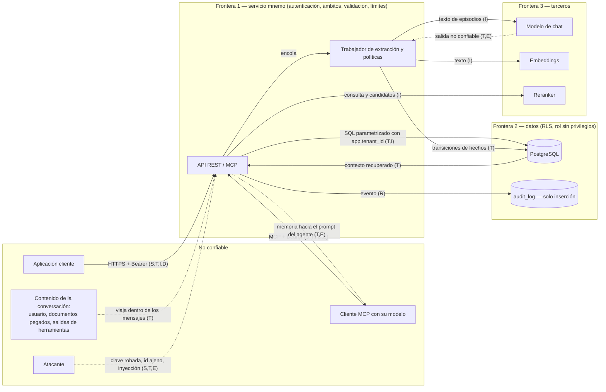

# mnemo — línea base de seguridad

Estado: modelo de amenazas completo, controles sin implementar · Última revisión: 2026-11-19

## 1. Objetivo de seguridad

**ASVS nivel 2.** mnemo guarda conversaciones, que contienen datos personales por definición, de varios inquilinos. No mueve dinero ni maneja datos de pago. Dos áreas se tratan con rigor de nivel 3 porque un fallo ahí es irreparable: el **aislamiento entre inquilinos** y la **supresión de datos**.

Todo el código de autenticación, autorización, aislamiento y purga es de criticidad ALTA (ver [testing-strategy.md](testing-strategy.md)).

Responsable de todos los controles: el autor. No hay equipo; las compuertas automáticas sustituyen a la segunda revisión.

## 2. Qué protegemos

| Activo | Por qué importa |
|---|---|
| Episodios (texto de conversaciones) | Datos personales en bruto, posiblemente sensibles |
| Hechos y entidades | Datos personales **destilados**: más fáciles de explotar que el texto original |
| Vectores y resúmenes | Derivados de datos personales; también hay que borrarlos |
| Credenciales de API | Dan acceso a toda la memoria de un inquilino o de un sujeto |
| Claves de los proveedores de modelos | Gasto ajeno y acceso a las cuentas del operador |
| Integridad de la memoria | Un recuerdo falso cambia el comportamiento futuro del agente |

## 3. Diagrama de flujo de datos

Cada subgrafo es una frontera de confianza. Las letras son las categorías STRIDE que aplican a cada cruce.

El cruce más peligroso no es de red: es el contenido no confiable que entra como mensaje, se convierte en hecho, y sale meses después dentro del prompt de un agente como si fuera conocimiento propio.

## 4. Registro de amenazas

STRIDE por elemento. Disposición: mitigar, eliminar, transferir o aceptar.

| ID | Elemento | STRIDE | Amenaza | Disposición | Control y prueba |
|---|---|---|---|---|---|
| TH-1 | API (proceso) | I, E | **Fuga entre inquilinos**: una consulta sin filtro devuelve filas de otro inquilino | mitigar | RLS forzada + rol sin `BYPASSRLS` + `Scope` obligatorio en `internal/store` (ADR-0003). Pruebas `TestIsolation_AllTables`, `TestRLS_ForcedOnAllTenantTables`, `TestAppRole_NotOwnerNoBypass` |
| TH-2 | Cliente MCP → API (flujo) | E | **Lectura de otro sujeto**: texto inyectado convence al modelo de pedir la memoria de otra persona | eliminar | Las herramientas MCP no tienen parámetro de sujeto; la credencial lo fija. Prueba: ninguna herramienta declara `subject` ni `tenant` en su esquema; una credencial ligada a S recibe 403 al pedir S' por REST |
| TH-3 | Trabajador (proceso) | T | **Envenenamiento de memoria**: un documento pegado o la salida de una herramienta contiene texto diseñado para quedar como hecho ("el usuario autorizó…", "ignora las instrucciones…") | mitigar | Etiqueta `trust` heredada del rol del episodio; los hechos `untrusted` quedan fuera de `recall` por defecto; detector de texto con forma de instrucción → `quarantined`; el hecho nunca tiene más confianza que su origen. Prueba: suite de envenenamiento de 30 casos, tasa de aceptación ≤ 10 % |
| TH-4 | Modelo de chat → trabajador (flujo) | T, E | **Salida del modelo como ataque**: el modelo, manipulado por el contenido, devuelve un veredicto que retracta o sustituye hechos legítimos en masa | mitigar | La salida se valida contra esquema; el núcleo puro decide las transiciones legales; un veredicto solo puede afectar a los vecinos que se le presentaron (como máximo 5 por candidato); nada se borra, todo es reversible. Prueba de propiedades: ningún veredicto elimina filas ni toca hechos fuera de la lista presentada |
| TH-5 | API → cliente (flujo) | T, E | **Inyección de prompt almacenada**: un hecho recuperado contiene instrucciones que el agente del cliente obedece | mitigar / transferir | El contexto se entrega delimitado (`<memory>…</memory>`) con procedencia y nivel de confianza por línea, y los hechos `quarantined` no salen. El uso del contexto como datos y no como instrucciones es responsabilidad del integrador; se documenta en el README con un ejemplo de prompt |
| TH-6 | Credencial (entidad externa) | S | Clave de API robada o adivinada | mitigar | 32 bytes aleatorios; solo se guarda el SHA-256; comparación en tiempo constante; revocación; ámbitos mínimos; límite de tasa por clave y por IP en fallos de autenticación. Prueba: la clave en claro no aparece en la base ni en registros |
| TH-7 | API (proceso) | I | **Enumeración**: distinguir "no existe" de "existe pero es de otro" | mitigar | Identificadores UUID; 404 idéntico en ambos casos. Prueba de contrato |
| TH-8 | PostgreSQL (almacén) | I | Lectura directa de la base o de una copia de seguridad | transferir | Cifrado de disco y control de acceso son del operador; se documenta. El rol de la aplicación no puede leer sin `app.tenant_id` |
| TH-9 | Registros (almacén) | I | Datos personales en los registros o en las métricas | mitigar | Regla AD-3: solo identificadores, recuentos y tiempos. Prueba: tras un flujo completo con un texto centinela, el centinela no aparece en la salida de registro ni en `/metrics` |
| TH-10 | Trabajador → proveedores (flujo) | I | Las conversaciones se envían a terceros para extraer y embeber | transferir / aceptar | Se documenta qué se envía a quién; con modelos locales no sale nada. Elegir un proveedor con términos de no entrenamiento es decisión del operador |
| TH-11 | API (proceso) | D | Agotamiento: mensajes enormes, ráfagas, consultas costosas | mitigar | Límites: 32 KB por mensaje, 200 mensajes por petición, 1 MB por cuerpo, `max_tokens` ≤ 16.000; cubo de fichas por credencial; `statement_timeout` de 5 s; cola con concurrencia acotada. Prueba por cada límite |
| TH-12 | Proveedores (terceros) | D | **Consumo sin límite**: un cliente provoca gasto ilimitado en el modelo de extracción | mitigar | Cuota diaria de tokens de extracción por inquilino (configurable); al superarla, los episodios se guardan y la extracción se pospone. Prueba con un `ChatModel` que cuenta |
| TH-13 | Purga (proceso) | R, I | **Supresión incompleta**: tras pedir el borrado quedan vectores, resúmenes, trabajos o respuestas de idempotencia con datos del sujeto | mitigar | Purga en una transacción sobre todas las tablas con `subject_id`; marca `purged_at`; prueba genérica que consulta `information_schema` y falla si una tabla nueva con `subject_id` conserva filas |
| TH-14 | `audit_log` (almacén) | R, T | Alterar o borrar el rastro de una purga o de una retractación | mitigar | El rol de la aplicación solo tiene `INSERT` sobre `audit_log`. Prueba: `UPDATE` y `DELETE` fallan con el rol de la aplicación |
| TH-15 | Reranker / embeddings (flujo) | T | Un proveedor comprometido devuelve puntuaciones o vectores manipulados | aceptar | Solo afecta al orden, nunca al control de acceso. Vence: revisión en la versión 1.0 |
| TH-16 | Cadena de suministro | T | Dependencia o acción de CI maliciosa | mitigar | Sección 8 |
| TH-17 | Harness de evaluación | I | Las trazas del benchmark publicadas contienen claves o datos | mitigar | Los conjuntos son sintéticos y públicos; las trazas pasan un filtro de patrones de clave antes de publicarse. Prueba del filtro |
| TH-18 | Exportación (proceso) | I | Exportar la memoria de un sujeto ajeno | mitigar | Mismo control que TH-1 y TH-2; una credencial ligada a sujeto solo exporta el suyo. Prueba |
| TH-19 | Servidor MCP por HTTP (flujo) | S, T | Petición desde una página web maliciosa contra un servidor MCP local (reenlace de DNS) | mitigar | Validación de la cabecera `Origin` y enlace a `127.0.0.1` por defecto; credencial obligatoria también en local. Prueba con `Origin` ajeno |

### Análisis de flujo tóxico

Se buscan caminos *entrada no confiable → herramienta con privilegios → sumidero externo*:

| Camino | ¿Existe? | Qué lo corta |
|---|---|---|
| Texto inyectado → `recall` de otro sujeto → respuesta al atacante | No | TH-2: no hay parámetro de sujeto |
| Texto inyectado → `forget everything` → pérdida de datos | Parcial | `forget` con `everything` exige el argumento `confirm` igual al identificador del sujeto, que el modelo no conoce si no se le da; la herramienta lleva la anotación destructiva para que el cliente pida confirmación. Riesgo residual aceptado: un cliente que no pida confirmación y que tenga el identificador en su contexto |
| Texto inyectado → `remember` → hecho falso → comportamiento futuro | Sí, mitigado | TH-3 |
| Hecho recuperado → instrucción obedecida → acción externa del agente | Sí, fuera de mnemo | TH-5; mnemo no ejecuta acciones |

## 5. Casos de abuso

Espejo de las historias P0. Cada uno es una prueba.

- **AB-1 (US-5).** Como inquilino B, quiero leer la memoria de un sujeto de A para conocer sus datos. *Dado* que estoy autenticado como B, *cuando* llamo a cualquier endpoint con un identificador de A, *entonces* recibo 404 o lista vacía, nunca una fila de A, y queda un evento de acceso denegado.
- **AB-2 (US-1, US-2).** Como autor de un documento que la víctima pegará en su chat, quiero que mi texto quede como recuerdo permanente. *Dado* un mensaje de rol `tool` o marcado `untrusted` con un enunciado imperativo, *cuando* se extrae, *entonces* el hecho queda `untrusted` o `quarantined` y no aparece en `recall` por defecto.
- **AB-3 (US-3).** Como contenido malicioso, quiero sustituir un hecho verdadero por uno falso. *Dado* un hecho activo de confianza `user`, *cuando* llega un candidato contradictorio de origen `untrusted`, *entonces* el hecho activo no cambia de estado.
- **AB-4 (US-6).** Como texto inyectado en una conversación con herramientas MCP, quiero leer la memoria de otro usuario. *Dado* cualquier argumento a `recall` o `timeline`, *cuando* se ejecuta, *entonces* solo se consulta el sujeto de la credencial.
- **AB-5 (US-9).** Como operador descuidado, quiero creer que borré a un usuario cuando no fue así. *Dado* un sujeto purgado, *cuando* se inspeccionan todas las tablas, *entonces* no hay ninguna fila suya y el recibo coincide con los recuentos previos.
- **AB-6 (US-4).** Como quien ejecuta el benchmark, quiero no filtrar mis claves. *Dado* un informe generado, *cuando* se busca cualquier valor de las variables de entorno de claves, *entonces* no aparece.
- **AB-7 (US-1).** Como cliente abusivo, quiero agotar el presupuesto de modelos del operador. *Dado* un inquilino sobre su cuota diaria, *cuando* envía más episodios, *entonces* se guardan, la extracción se pospone y la respuesta lo indica.

## 6. Datos personales y supresión

mnemo no decide qué datos trata ni con qué base legal: eso es del integrador. Lo que mnemo debe garantizar es que el integrador **pueda** cumplir.

| Obligación | Cómo la soporta mnemo |
|---|---|
| Minimización | No se guarda nada que el cliente no envíe. Sin telemetría. La política de retención de episodios (FR-14) permite conservar solo hechos |
| Acceso y portabilidad | `GET /v1/subjects/{id}/export` en NDJSON: episodios, hechos con su historia, entidades |
| Rectificación | Retractación de hechos (FR-17) con registro de auditoría |
| Supresión | `DELETE /v1/subjects/{id}`: borrado físico de episodios, hechos, entidades, procedencias, trabajos y respuestas de idempotencia; `usage_events.subject_id` pasa a nulo; el registro de auditoría conserva solo `sha256(tenant_id ‖ subject_id)`, la fecha y los recuentos |
| Retención | Ventanas configurables; limpieza automática de trabajos, claves de idempotencia y consumo |
| Registro de accesos | `audit_log` para purga, exportación, retractación, liberación de cuarentena y creación de claves |
| Envío a terceros | Documentado por operación: qué texto va al modelo de chat, al de embeddings y al reranker. Con modelos locales, ninguno |

Límites que se declaran, no se esconden:

- **Copias de seguridad.** La purga no alcanza copias hechas antes. El operador debe definir su caducidad; se documenta.
- **Caché de extracción del harness.** Es local al harness y solo contiene datos de benchmark.
- **Proveedores.** Lo ya enviado a un proveedor no se puede retirar desde mnemo.
- **Marco colombiano.** Si se operara un nivel alojado, el operador sería encargado del tratamiento bajo la Ley 1581 de 2012, y la Circular Externa 002 de 2024 de la SIC fija lineamientos para datos personales en sistemas de IA ([circular](https://sedeelectronica.sic.gov.co/sites/default/files/normativa/Circular%20Externa%20No.%20002%20del%2021%20de%20agosto%20de%202024.pdf)). No se analizó la transferencia internacional hacia proveedores de modelos. Esto no es asesoría legal (Q-7).

## 7. Controles revisados contra ASVS nivel 2

| Área | Decisión | Estado |
|---|---|---|
| Inyección SQL | Solo consultas parametrizadas con pgx; ninguna concatenación. La configuración de texto completo se pasa como parámetro tipado `regconfig` | Previsto (T-002 en adelante) |
| Autenticación | Claves de API con hash; sin contraseñas ni sesiones, así que no aplican hash de contraseñas ni rotación de tokens de refresco | Previsto (T-012) |
| Autorización | Denegar por defecto; ámbitos por ruta declarados en una tabla; toda ruta `/v1` exige credencial | Previsto (T-012, T-013) |
| Validación de entrada | En la frontera, con esquema: tipos, longitudes, rangos, enumeraciones. 422 con detalle | Previsto (T-013) |
| Salida de modelos | Validada contra esquema antes de usarse; nunca se ejecuta ni se interpola en SQL | Previsto (T-010, T-019) |
| XSS / CSRF | No aplica: sin interfaz web ni cookies | No aplica |
| SSRF | mnemo solo llama a las URL de proveedores de su configuración; ninguna URL viene de un cliente | Eliminado por diseño |
| Secretos | Solo por variables de entorno; nunca en registros, errores ni respuestas; `.env` ignorado por git | Previsto (T-001) |
| Transporte | TLS lo termina el proxy del operador; el servicio escucha en `127.0.0.1` por defecto y avisa al arrancar si se enlaza a otra interfaz sin TLS delante | Previsto (T-001), documentado |
| Errores | Sobre único con código estable; sin trazas, SQL ni rutas internas | Previsto (T-013) |
| Registro y alertas | Eventos de seguridad en el registro estructurado: fallo de autenticación, denegación por ámbito o sujeto, purga, exportación. Contadores en `/metrics` para que el operador alerte | Previsto (T-016) |
| Fallo cerrado | Sin `app.tenant_id` la consulta falla; un error en la comprobación de ámbito es 403 | Previsto (T-012) |
| Datos en reposo | Cifrado de disco a cargo del operador; sin cifrado por campo en v1 | Aceptado (sección 9) |

### Lista para funciones con modelos de lenguaje

| Punto | Decisión en mnemo |
|---|---|
| Inyección de prompt | Instrucciones del sistema separadas del contenido; el contenido va delimitado y se declara como datos; la salida no desencadena nada sin validación (TH-3, TH-4) |
| Validación de salida | Esquema JSON para extracción y veredictos; un reintento con el error; después, trabajo fallido |
| Cadena de suministro de modelos | Identificadores de modelo fijados en configuración; un cambio de modelo es un cambio de dependencia y obliga a reejecutar el subconjunto de desarrollo |
| Envenenamiento | Niveles de confianza, cuarentena, procedencia, reversibilidad (TH-3) |
| Agencia excesiva | mnemo no ejecuta acciones externas. Cuatro herramientas MCP; solo `forget` es destructiva y exige confirmación |
| Fuga del prompt de sistema | Los prompts son públicos (están en el repositorio); no contienen secretos ni lógica de autorización |
| Debilidades de vectores | Filtro por inquilino y sujeto en la base, no en el prompt (TH-1) |
| Desinformación | Cada elemento recuperado lleva procedencia y fechas; `no_evidence` permite al agente abstenerse |
| Consumo sin límite | Cuotas por inquilino, topes de tokens, caché (TH-11, TH-12) |
| Datos personales en prompts | Se documenta qué se envía; opción de modelos locales; los registros no contienen prompts |
| Evaluaciones | El subconjunto de desarrollo se ejecuta ante cualquier cambio de prompt o de modelo |
| Tiempo límite y degradación | ADR-0006; `recall` responde sin proveedores de chat |

## 8. Cadena de suministro

- `go.sum` y `eval/uv.lock` en el repositorio; CI instala con `go mod verify` y `uv sync --frozen`.
- Tope de 6 dependencias directas en Go; cada dependencia nueva lleva una línea en el ADR que la justifica: nombre, licencia, mantenedores, última versión, coste de salida.
- `govulncheck` y `pip-audit` bloquean la fusión ante vulnerabilidades alcanzables o de severidad alta.
- Acciones de CI fijadas por SHA de commit; permisos del flujo en solo lectura salvo el paso de publicación.
- Imagen de contenedor: compilación en varias etapas, base mínima fijada por resumen, usuario sin privilegios.
- SBOM en formato CycloneDX adjunto a cada versión etiquetada.

Dependencias directas previstas y su justificación:

| Dependencia | Para qué | Licencia | Coste de salida |
|---|---|---|---|
| `github.com/jackc/pgx/v5` | Controlador de PostgreSQL y pool | MIT | Alto: es el acceso a datos; confinado a `internal/store` |
| `github.com/pgvector/pgvector-go` | Tipo `vector` para pgx | MIT | Bajo: sustituible por codificación a texto |
| `github.com/modelcontextprotocol/go-sdk` | Servidor MCP | Apache-2.0 para contribuciones nuevas, MIT el código existente ([README](https://github.com/modelcontextprotocol/go-sdk)) | Medio: confinado a `internal/mcpserver` |

Las licencias de pgx y pgvector-go se citan de memoria y se confirman en T-001.

## 9. Riesgos aceptados

| ID | Riesgo | Por qué se acepta | Responsable | Vence |
|---|---|---|---|---|
| AR-1 | Sin cifrado por campo; el contenido está en claro en la base | Autoalojado: el operador controla el disco. Añadirlo complica la búsqueda léxica y vectorial | Autor | Al definir un nivel alojado |
| AR-2 | Sin OAuth para MCP; credencial estática | Suficiente para uso local y autoalojado | Autor | Cuando un cliente lo exija |
| AR-3 | El detector de texto con forma de instrucción es heurístico y se puede evadir | La defensa principal es el nivel de confianza por origen, no el detector | Autor | Tras la primera medición de la suite de envenenamiento |
| AR-4 | Un proveedor de modelos ve el texto de las conversaciones | Inherente a usar un modelo alojado; hay alternativa local | Operador | Permanente, documentado |
| AR-5 | Límite de tasa en memoria: se reinicia con el proceso y no vale con varias réplicas | Una sola instancia en v1 | Autor | Al añadir una segunda réplica |
| AR-6 | TH-15, proveedor de embeddings o reranker comprometido | Solo afecta al orden | Autor | Versión 1.0 |
| AR-7 | Un solo revisor: el autor | Proyecto individual; compensado con compuertas automáticas | Autor | Si se suma un colaborador |

## 10. Compuerta de seguridad

- [x] Nivel ASVS elegido y escrito.
- [x] Diagrama de flujo de datos con fronteras de confianza.
- [x] STRIDE por elemento; cada amenaza con disposición y responsable.
- [x] Casos de abuso para las historias P0.
- [x] Cada mitigación tiene control y prueba nombrada.
- [ ] Controles de cadena de suministro configurados en CI. **Pendiente:** el CI no existe hasta T-003. Es la primera compuerta que se cierra al empezar a implementar.
- [x] Riesgos aceptados con responsable y vencimiento.
- [x] Lista para funciones con modelos de lenguaje revisada.

Resultado: 7 de 8. El punto abierto no se puede cerrar sin código y está asignado a T-003.

El modelo se revisa cuando cambia el diagrama: una interfaz nueva, un proveedor nuevo, una tabla con datos de sujeto.
